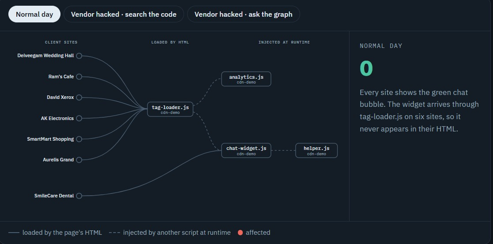
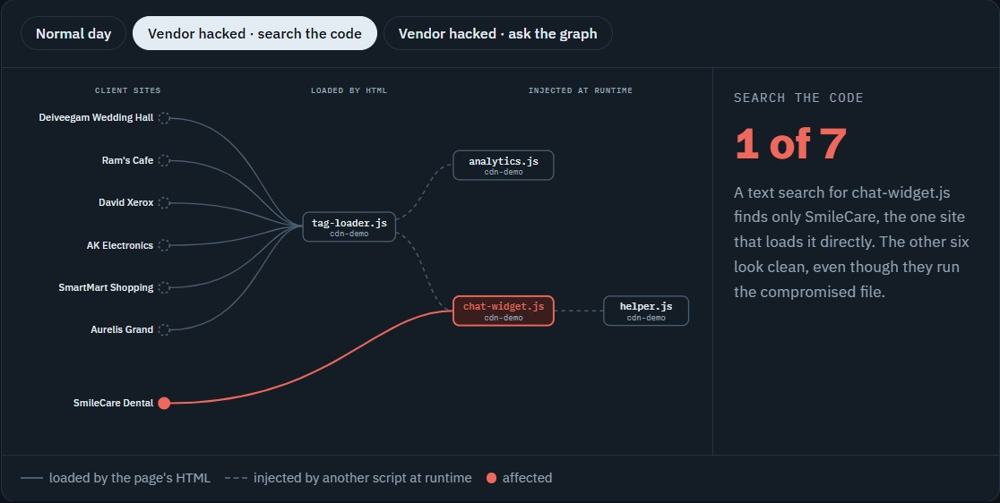
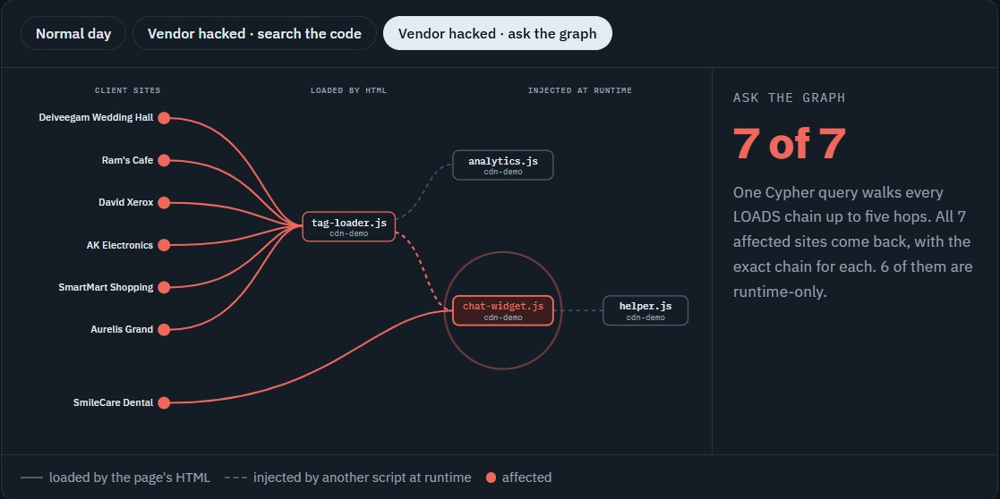
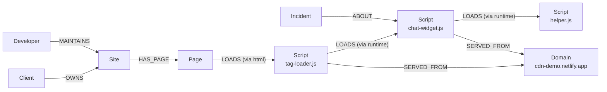

# Blast Radius: Script Supply-Chain Agent

**When a third-party script used on your clients' websites is hacked, Blast Radius tells you in seconds which client sites and pages are hit, including the ones where the script never appears in the site's own code, and hands you a fix to approve.**

Built on **FalkorDB** for **Graph Hacks 2026**. Track: **01, Agents That Act on Connected Data**.

> **In our live test, a code search found 1 affected client site. The graph found all 7, and 6 of them were hidden from the code.**

🎥 **Demo video:** https://youtu.be/B-1rQZDAv8U
📝 **Blog:** [One Hacked Script, Seven Websites: Following the Trail with FalkorDB](https://medium.com/@kaveesw123/one-hacked-script-seven-websites-following-the-trail-with-falkordb-6945af7b1292)
💻 **Run it locally in about 10 minutes:** see [Run it yourself](#run-it-yourself).

---

## The problem

A small web agency looks after dozens of client websites. Each one loads third-party scripts: chat widgets, analytics, tag managers. Many of those scripts **load more scripts at runtime**, so they never appear in the site's HTML.

When a vendor is compromised (as with Polyfill.io in 2024), the agency has to answer three questions fast:

1. **Which of my clients are affected?**
2. **On which pages, and through which chain of scripts?**
3. **What exact fix do I apply to each site?**

Searching the HTML (`grep`) misses every site where the bad script is loaded *by another script*. That's a multi-hop question, which is exactly what a graph answers well.

### See it in three pictures

**1. A normal day.** Six sites get the chat widget through `tag-loader.js`, so it never appears in their HTML. Only SmileCare loads it directly.



**2. The vendor is hacked: search the code.** A text search finds only 1 of the 7 affected sites.



**3. The vendor is hacked: ask the graph.** One FalkorDB query follows every chain and finds all 7, with the exact path for each.



## What we built and what we proved

Our team runs a small web startup, so we built **7 realistic client websites** the same way we build sites for local businesses: a wedding hall, a cafe, a dental clinic, a hotel, shops. You can't safely hack a real client's site, so we also built our own harmless CDN, "hacked" one file on it (`chat-widget.js`), and let the system respond. Result on the live sites:

- The **watcher** noticed the file's fingerprint (SHA-256) changed and raised an alarm.
- **FalkorDB** found **7 affected pages on 7 client sites. 6 of them load the script only at runtime** through `tag-loader.js`, so it is not in their HTML.
- The **fix maker** produced a different, correct fix per site:
  - the site that loads the script directly: **pin the known-good copy with an SRI hash**
  - the 6 hidden sites: **pause the loader script** (SRI cannot protect a script injected at runtime) plus a **Content-Security-Policy** built from each site's real script domains in the graph
  - a plain-language **message for each client**
- A human clicks **Approve**. Nothing changes without approval.
- Every answer shows **"What FalkorDB did"**: the exact Cypher, the row counts and the time per step.

## How it works

```
 crawler (Playwright + Chrome DevTools)          watcher (re-downloads every script)
   records every script and WHO loaded it            compares SHA-256 with the graph
              │                                               │ hash changed
              ▼                                               ▼
        crawler/ingest.py ───────────►  FalkorDB  ◄──── creates an Incident
                                     (the dependency map)
                                           │
                     fixed Cypher tools (graph/queries.py)
                     ┌─────────────────────┼─────────────────────┐
                     ▼                     ▼                     ▼
               fix maker              Gemini agent           MCP server
         SRI · CSP · patch · msg   answers questions       same tools for any
                     │              using only the tools    MCP client (Antigravity,
                     ▼                                       Claude Desktop)
          FastAPI  ──►  React dashboard  ──►  human Approve
```

**Who loaded which script:** the crawler opens each page in headless Chromium and listens to the Chrome DevTools `Network.requestWillBeSent` event. The *initiator* stack tells us whether a script came from the page's HTML or was injected by another script. That parent → child link becomes an edge in the graph.

## Graph model



**How the agent uses it:** when a script changes, the agent walks `Client → Site → Page → LOADS*1..5 → Script` to find every affected page, including pages that reach the script only through other scripts. It then reads each site's `SERVED_FROM` domains to build that site's CSP, and `MAINTAINS` to know who to notify.

```
(:Client)-[:OWNS]->(:Site)-[:HAS_PAGE]->(:Page)-[:LOADS {via:'html'}]->(:Script)
(:Script)-[:LOADS {via:'runtime'}]->(:Script)          // script injects script
(:Script)-[:SERVED_FROM]->(:Domain)
(:Developer)-[:MAINTAINS]->(:Site)
(:Incident)-[:ABOUT]->(:Script)
```

- `Script.sha256`, `previous_sha256` and `changed_at` are set by the watcher.
- A path longer than `Page → Script` means **runtime only** (not visible in the HTML).

## The key Cypher queries

**Blast radius of a script** (multi-hop, any depth up to 5):
```cypher
MATCH path = (c:Client)-[:OWNS]->(s:Site)-[:HAS_PAGE]->(p:Page)-[:LOADS*1..5]->(sc:Script)
WHERE sc.url = $url
RETURN c.name AS client, s.url AS site, p.url AS page,
       [n IN nodes(path)[2..] | n.url] AS chain,
       length(path) > 3 AS runtime_only
```

**Blast radius of a whole domain:**
```cypher
MATCH path = (c:Client)-[:OWNS]->(s:Site)-[:HAS_PAGE]->(p:Page)-[:LOADS*1..5]->(sc:Script)
WHERE (sc)-[:SERVED_FROM]->(:Domain {name: $domain})
RETURN c.name, s.url, p.url, [n IN nodes(path)[2..] | n.url], length(path) > 3
```

**Single points of failure** (domains that reach the most client sites):
```cypher
MATCH (s:Site)-[:HAS_PAGE]->(:Page)-[:LOADS*1..5]->(:Script)-[:SERVED_FROM]->(d:Domain)
WHERE d.first_party = false
RETURN d.name AS domain, count(DISTINCT s) AS sites_reached
ORDER BY sites_reached DESC LIMIT $limit
```

**Per-site CSP input** (every domain a site really loads scripts from):
```cypher
MATCH (s:Site {url: $site})-[:HAS_PAGE]->(:Page)-[:LOADS*1..5]->(:Script)-[:SERVED_FROM]->(d:Domain)
RETURN DISTINCT d.name AS domain, d.first_party AS first_party
```

All queries are in `graph/queries.py`. Each one returns its rows **and** a trace (Cypher, parameters, row count, time), which the dashboard shows. The agent and the MCP server can only call these fixed tools; they never write free-form Cypher.

## Run it yourself

**Needs:** Python 3.11+, Node 18+, and a FalkorDB instance (FalkorDB Cloud free tier, or local Docker).

```bash
# 1. Database
docker compose up -d                 # local FalkorDB, or use FalkorDB Cloud
cp .env.example .env                 # fill in FALKORDB_HOST/PORT/USERNAME/PASSWORD, GEMINI_API_KEY

# 2. Python
pip install -r requirements.txt
pip install playwright && playwright install chromium

# 3. Build the map from real websites
python crawler/crawl.py              # visits the sites in crawler/sites.json
python crawler/ingest.py             # loads third-party scripts into FalkorDB
python watcher/watch.py --once       # stores the known-good fingerprints

# 4. API + dashboard
uvicorn api.main:app --port 8000     # http://localhost:8000/docs
cd web && npm install && npm run dev # http://localhost:5173
```

**Try the hack:** deploy `demo-sites/cdn-hacked` in place of `demo-sites/cdn`, then run `python watcher/watch.py --once`. The alarm appears on the dashboard within 5 seconds. The dashboard's **Simulate hack** button does the same without touching the CDN.

**Start fresh:** `python seed/reset_graph.py` (asks you to type YES), then run ingest and the watcher again.

**MCP:** see `agent/MCP_README.md` to connect the same tools to Antigravity or Claude Desktop.

## Folders

| Folder | What is in it |
|---|---|
| `crawler/` | Playwright crawler, `sites.json` (client list), `ingest.py` (crawl → graph) |
| `watcher/` | Re-downloads every script, compares fingerprints, creates incidents |
| `graph/` | The Cypher tools (`queries.py`) |
| `fixer/` | Fix maker: SRI from the known-good copy, CSP, patch, client message |
| `agent/` | Gemini agent (tool calling) and MCP server |
| `api/` | FastAPI backend for the dashboard |
| `web/` | React + Vite + Cytoscape dashboard |
| `demo-sites/` | Harmless demo CDN (`cdn/`) and its "hacked" copy (`cdn-hacked/`) |
| `seed/` | `reset_graph.py` (empty the map) and the original dummy seed |
| `contracts/` | Shared formats: graph schema, crawl JSON, API |

## Honest limits

- The 7 client websites are realistic sites we built for this test, not live customer sites, and the CDN is our own. That's what let us run a real attack simulation safely. The "hack" only adds a visible red banner.
- We crawl each site's home page; a real deployment would crawl more pages and re-crawl on a schedule.
- The watcher detects that a file *changed*, not whether the change is malicious. It treats any unexpected change as an incident for a human to review.
- **Approve** records the decision in the graph; opening the pull request on the client's repo is not connected yet.
- Render's free tier sleeps when idle, so the first request can take about 50 seconds.

## What's next

- Re-crawl on a schedule and alert on **new** scripts, not just changed ones.
- Import public advisories (e.g. known-bad domains) as `(:Advisory)-[:FLAGS]->(:Domain)` and alert before a hash even changes.
- Open the fix as a real pull request after approval.

## AI tools used (disclosure)

We used **Claude** (planning, code review, parts of the code and docs), **Claude Code** and **Google Antigravity** (coding help), and **Gemini 2.5 Flash-Lite** (the agent's answers inside the product). Every file was run and reviewed by the team, and each of us can explain our part.

## Team

Built by a team of 4 for Graph Hacks 2026 (WeMakeDevs × FalkorDB).
